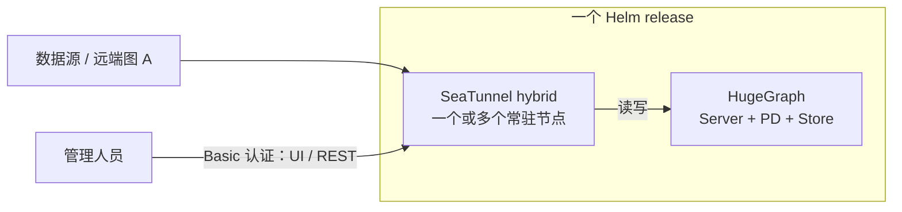

本文适用于 HugeGraph **1.8.0 及以后版本**，需要支持 OCI 的 Helm **3.10+** 和 Kubernetes (K8s) **1.23+**。
可从 GHCR 或 Docker Hub 安装 `hugegraph-helm`。Chart 与 HugeGraph 服务分别维护版本，例如 `0.2.x` 的 Chart 可以部署 `1.8.x` 的服务。

> [!WARNING]
> 当前开发 Chart 使用 `latest` 镜像，适合测试。
> 对应 HugeGraph 服务正式发布后，生产环境请选择稳定 Chart，并检查其中的镜像版本。
> 镜像标签可能变化；需要固定镜像内容时，请配置各组件的 `image.digest`。

[Artifact Hub](https://artifacthub.io/packages/helm/hugegraph-helm/hugegraph-helm) 方便查找 Chart、查看版本和安装说明，实际安装包仍从 GHCR 或 Docker Hub 下载。
参数和源码开发方式见 [chart README](https://github.com/apache/hugegraph/blob/master/helm/hugegraph/README.md)，
生命周期操作见 [运维参考](https://github.com/apache/hugegraph/blob/master/helm/hugegraph/docs/operations.md)。


## 1 安装

> [!NOTE]
> **默认部署规格与存储要求**
> - **拓扑组成**：默认部署 **3 PD + 3 Store + 3 Server 与 1 Hubble**，默认开启鉴权与持久化存储。
> - **存储依赖**：需要集群具备默认动态 StorageClass 或预先匹配的静态 local PV，共需 7 个持久卷（3 个 10 GiB PD 卷、3 个 50 GiB Store 卷、1 个 1 GiB Hubble 卷）。
> - **内存考量**：保留镜像内 JVM 内存自动推导；按需调整 resource requests/limits，确保宿主机给 9 个图服务 JVM 与 Hubble 提供足够内存。

选择一个下载源即可，公共 CI 推荐 GHCR。本地轻量测试可直接使用单节点预设。

> [!TIP]
> `--devel` 按版本号选择最新 Chart，包含开发版和稳定版，不限于某个版本系列。
> 生产部署或需要复现时，将 `--devel` 换成 `--version <已发布版本>`，固定你选定的版本。

```bash {tab="GHCR（推荐）"}
CHART=oci://ghcr.io/hugegraph/hugegraph-helm
kubectl config current-context
kubectl get nodes
kubectl get storageclass
helm install hugegraph "$CHART" --devel -n hugegraph \
  --create-namespace --wait --timeout 15m
```

```bash {tab="Docker Hub"}
CHART=oci://registry-1.docker.io/hugegraph/hugegraph-helm
kubectl config current-context
kubectl get nodes
kubectl get storageclass
helm install hugegraph "$CHART" --devel -n hugegraph \
  --create-namespace --wait --timeout 15m
```

```bash {tab="单节点试用"}
# 适合本地 Minikube/Kind 等轻量测试；直接安装本次下载的 Chart
CHART=oci://ghcr.io/hugegraph/hugegraph-helm
helm pull "$CHART" --devel --untar
helm install hugegraph ./hugegraph-helm -n hugegraph \
  -f ./hugegraph-helm/values-single.yaml \
  --create-namespace --wait --timeout 10m
```

单节点试用预设替代默认安装，将各组件设为 1 副本并放宽调度限制，适合资源受限环境。

## 2 模式和访问入口

解压后目录为 `hugegraph-helm/`，源码目录仍为 `helm/hugegraph/`。

```filetree {wrap=true title="HugeGraph Helm 核心文件与结构"}
hugegraph-helm/
  Chart.yaml            # Chart 元数据与版本定义
  values.yaml           # 默认配置（easy 模式：3 PD + 3 Store + 3 Server + 1 Hubble，NodePort 入口）
  values-single.yaml    # 单节点预设（本地 Minikube/Kind 测试，1 副本且关闭反亲和与 PDB）
  values-cluster.yaml   # 生产集群预设（跨节点反亲和调度，Store 采用 OnDelete 逐个滚动升级）
  values-strict.yaml    # 安全加固预设（strict 模式：全部 ClusterIP，强制启用 NetworkPolicy 隔离）
  values.schema.json    # values 配置参数校验规范
  templates/            # Kubernetes 资源编排模板
    pd-statefulset.yaml   # PD 服务有状态副本集（元数据与调度中心）
    store-statefulset.yaml # Store 存储节点有状态副本集（分布式存储引擎）
    server-deployment.yaml # Server 引擎无状态 Deployment（注入 serviceId / graphSpace）
    hubble-deployment.yaml # 可视化控制台 Deployment
    tests/              # 冒烟验证测试钩子（helm test，支持自定义 testGraphAlias）
  examples/             # 7 种生产场景完整示例（含 local PV、GitOps 凭据、Ingress 等）
  docs/operations.md    # 生命周期进阶运维与故障恢复手册
```

默认 `mode: easy`，Server 和 Hubble 自动分配 NodePort，PD 保持 ClusterIP。可以直接使用 HTTP，无需域名、证书或额外确认参数。
`mode: strict` 默认将 Server/Hubble 设为 ClusterIP，并开启 NetworkPolicy。两个模式都保留鉴权和持久化。
优先级是组件显式参数高于全局参数，全局参数高于模式默认值，显式 `false` 也会生效。
全局参数包括 `persistence.enabled` 和 `global.imageRegistry`，严格预设为 `values-strict.yaml`。

| 入口 | 访问方式 | 前提 |
|---|---|---|
| NodePort | `http://<可达节点IP>:<分配的NodePort>` | 节点网络可达且防火墙放行，无需额外控制器 |
| ClusterIP | 集群内虚拟 Service IP/DNS，如 `hugegraph-server.hugegraph.svc:8080` | 集群外通过 port-forward 或已有网关访问 |
| LoadBalancer | 基础设施分配的地址 | 集群有对应负载均衡控制器 |
| Ingress | 通过控制器路由 HTTP 请求 | 已安装 Ingress 控制器，域名和 TLS 都可选 |

```bash
kubectl -n hugegraph get svc hugegraph-server hugegraph-hubble
kubectl get nodes -o wide
kubectl -n hugegraph get secret hugegraph-admin \
  -o jsonpath='{.data.password}' | base64 --decode
```

使用 Hubble 的 NodePort 打开页面，以 `admin` 和查出的密码登录。
默认 `externalTrafficPolicy: Cluster` 下，访问的节点不必运行目标 Pod。ClusterIP 是集群内部的虚拟服务地址，不是节点 IP，普通笔记本通常不能直接访问。
也可以运行 `kubectl -n hugegraph port-forward svc/hugegraph-hubble 8088:8088`，在本机打开 `http://127.0.0.1:8088`。

三个客户端 Service 都支持 `externalTrafficPolicy`、`loadBalancerClass`、`loadBalancerIP`、`loadBalancerSourceRanges`、`externalIPs`
和 `allocateLoadBalancerNodePorts`，具体行为取决于集群及负载均衡实现。LoadBalancer 专用字段应配合对应类型使用。
NodePort 省略或设为 `0` 时自动分配，固定端口由 Kubernetes 根据集群配置的范围校验，chart 不再强制 `30000–32767`。
原 HTTP 暴露确认参数保留兼容，但不再阻止渲染。

### 服务身份与图空间

默认 `server.serviceId` 与 `server.graphSpace` 均为 `DEFAULT`。如需将 Server 注册到指定的业务服务名或图空间，可通过 values 指定：

仅修改已有部署的配置时，保留当前 Chart 版本和 values。用 `helm list` 查看版本，替换下面的版本占位符：

```bash
helm list -n hugegraph
CHART=oci://ghcr.io/hugegraph/hugegraph-helm
CHART_VERSION='<已安装的Chart版本>'
helm upgrade hugegraph "$CHART" --version "$CHART_VERSION" -n hugegraph --reuse-values \
  --set-string server.serviceId=analytics \
  --set-string server.graphSpace=team_a \
  --set-string server.testGraphAlias=team_a-demo
```

注意：非默认图空间必须在启动 Server 前先调用 PD API 创建；`server.testGraphAlias` 用于指定 `helm test` 验证的 Gremlin 图别名（区分大小写），
不会从 `graphSpace` 自动推导。请勿在 `server.extraEnv` 中重复声明服务 ID 或图空间。

## 3 内网镜像和存储

[完整例子](https://github.com/apache/hugegraph/tree/master/helm/hugegraph/examples)包含内网镜像、动态存储、七个 local PV、
GitOps 凭据、仅 API 部署以及无域名的 HTTP Ingress。

`global.imageRegistry` 为未指定 registry 的镜像仓库加前缀，组件指定完整 registry 地址时优先采用组件配置。
默认只需镜像仓库中的 `hugegraph/pd`、`hugegraph/store`、`hugegraph/server` 和 `hugegraph/hubble` 四个镜像，标签或 digest 按实际配置选取。
等待 PD 的 init container 复用 Store 镜像，Helm test 复用 Server 镜像。这两个镜像已包含 `curl`，无需额外 curl 镜像或启动时安装软件。
自定义镜像可以继续使用显式 `store.waitImage` 和 `server.waitImage` 覆盖。

### 存储配置

`storageClassName` 为空时继承集群默认 StorageClass，`"-"` 表示显式不使用 StorageClass。
local PV 需要预建宿主机目录、匹配容量、`nodeAffinity` 和 `kubernetes.io/no-provisioner` StorageClass。
`WaitForFirstConsumer` 根据 Pod 调度约束绑定，创建资源前请查看七个卷的完整例子。
新建临时实例可以设置 `persistence.enabled=false` 使用 `emptyDir`，组件存储开关优先。
PVC 失败不会自动降级为临时存储，已经初始化的 PD/Store 切换存储模式会被拒绝。

### 离线安装和私库

先选择最新版本，再按该版本下载 Chart，将 `.tgz` 搬入内网。可以直接安装，也可以接入已有的 OCI 或 HTTP 私库。
内网安装需通过 `--set global.imageRegistry=...` 覆盖镜像私库，
参见 [values-internal-registry.yaml](https://github.com/apache/hugegraph/blob/master/helm/hugegraph/examples/values-internal-registry.yaml)。

```bash
CHART=oci://ghcr.io/hugegraph/hugegraph-helm
CHART_VERSION=$(helm show chart "$CHART" --devel | sed -n 's/^version: //p')
helm pull "$CHART" --version "$CHART_VERSION"
```

```bash {tab="直接安装"}
# 内网环境需覆盖镜像私库（或使用 -f values-internal-registry.yaml）
helm install hugegraph "./hugegraph-helm-${CHART_VERSION}.tgz" -n hugegraph \
  --set global.imageRegistry=registry.example.com \
  --create-namespace --wait --timeout 15m
```

```bash {tab="OCI 私库"}
helm registry login registry.example.com
helm push "./hugegraph-helm-${CHART_VERSION}.tgz" oci://registry.example.com/charts
helm install hugegraph oci://registry.example.com/charts/hugegraph-helm \
  --version "$CHART_VERSION" -n hugegraph \
  --set global.imageRegistry=registry.example.com \
  --create-namespace --wait --timeout 15m
```

```bash {tab="HTTP 私库"}
# 按私库的上传方式接收同一个 .tgz，并更新 index.yaml。
# 自建静态 HTTP 源可用 helm repo index 生成索引；helm push 只适用于 OCI。
helm repo add hugegraph-internal https://charts.example.com
helm repo update hugegraph-internal
helm install hugegraph hugegraph-internal/hugegraph-helm \
  --version "$CHART_VERSION" -n hugegraph \
  --set global.imageRegistry=registry.example.com \
  --create-namespace --wait --timeout 15m
```

私库地址请替换为实际地址。Chart 包不包含容器镜像；完整离线部署还需搬运配置引用的所有容器镜像，并覆盖镜像地址。

## 4 鉴权和 Secret

普通 Helm 安装自动生成、复用三份凭据，分别为 `<release>-admin` 的 `password`、`<release>-auth-token` 的 `token_secret`
以及 `<release>-pd-auth` 的 `secret-key`。PD REST 使用共享的 PD Secret，通过 `HG_PD_AUTH_SECRET_KEY` 注入 PD 容器，
Server 等待存储和 Hubble 使用同一份凭据，不需要用户为每个 PD Pod 单独发明密码。

GitOps 使用加密的固定值，或预先创建 Secret 并配置 `pd.auth.existingSecret`、`server.auth.admin.existingSecret`
和 `server.auth.token.existingSecret`。`existingSecret` 高于内联值，chart 不管理这类外部 Secret。
管理员密码需要可打印 ASCII，不能包含空格、冒号、反斜杠；PD 密码需要可打印 ASCII，不能包含首尾空白和反斜杠；JWT key 至少 32 字节。
离线渲染器不能通过 `lookup` 读取在线已生成 Secret，因此不能依赖每次渲染随机生成凭据。

管理员 Secret 是**初始凭据**，更新 Secret 不会修改已经创建的账户密码。
先使用旧密码调用 `PUT /graphspaces/DEFAULT/auth/users/admin`，请求体为 `{"user_password":"<新密码>"}`，
再把 Secret 和源配置同步为新密码，最后重启 Server Deployment 清理所有副本的鉴权缓存。

Hubble 默认开启，当前镜像的登录仍依赖 Server 鉴权。只使用 API 可以设置 `hubble.enabled=false`，
如需关闭 API 鉴权，再设置 `server.auth.enabled=false`。未使用的凭据配置可以留在 values 中。

## 5 升级和验证

使用 Helm 原生值复用保留已有部署的 UI、入口、存储和凭据设置。

```bash
helm get values hugegraph -n hugegraph --all
# 测试环境继续跟随最新版本；生产升级请改用 --version 指定已审阅的稳定版本。
helm upgrade hugegraph "$CHART" --devel -n hugegraph \
  --reuse-values --wait --timeout 15m
helm test hugegraph -n hugegraph --logs --timeout 5m
```

已有配置中的显式 helper 镜像也会保留。添加 `--set-string store.waitImage= --set-string server.waitImage=` 可清空覆盖并复用组件镜像。
要采用新的默认值，先审阅已有配置，再使用 `--reset-values` 和保留镜像、凭据、存储、拓扑设置的配置文件。
PD 成员、持久存储和共享凭据变更需要按生命周期说明协调处理。

`server.storageWaitTimeoutSeconds` 默认 300，通过 `WAIT_STORAGE_TIMEOUT_S` 传给启动脚本。
未指定的启动探针阈值按存储等待加 150 秒推导；显式探针不会被改写，但预算必须覆盖存储等待和至少 120 秒 Server 启动时间。
矛盾预算会在渲染时报出对应参数。这个等待超时不是 JVM 内存配置。

默认 `helm test` hook 检查连接和读取。安装或恢复后，还应重新登录 UI，并验证应用实际使用的读写查询。
调度、NetworkPolicy、滚动升级和恢复见 [Kubernetes 运维](./hugegraph-helm-operations.md)。

## 6 同时启动 SeaTunnel

SeaTunnel 默认关闭。开启后，Helm 会启动常驻的 SeaTunnel 引擎，并带上内置任务前端。
官方 `apache/seatunnel:3.0.0` 镜像已包含 HugeGraph Source/Sink，无需另做镜像或安装插件。

> [!NOTE]
> 本节需要包含 `seatunnel` 配置的 Chart，功能对应[代码 PR #333](https://github.com/hugegraph/hugegraph/pull/333)。
> 在该功能合入并发布前，请使用对应源码分支；不要假定上文下载的 OCI 包已包含它。
> 以下命令在 HugeGraph 源码根目录执行。



### 6.1 选择单机或集群

hybrid 节点同时负责调度和执行。单机是一个常驻节点，集群是多个同类节点；它们使用同一套 StatefulSet。
HugeGraph 的副本数与 SeaTunnel 模式独立选择，例如 1 PD + 1 Store + 1 Server 也能配两个 SeaTunnel 节点。

新建测试环境时，选择下面一种方式。`values-single.yaml` 只设置 HugeGraph 的单副本拓扑。

```bash {tab="SeaTunnel 单机"}
helm install hugegraph ./helm/hugegraph -n hugegraph --create-namespace \
  -f helm/hugegraph/values-single.yaml \
  -f helm/hugegraph/examples/values-seatunnel-standalone.yaml \
  --wait --timeout 30m
```

```bash {tab="SeaTunnel 集群"}
helm install hugegraph ./helm/hugegraph -n hugegraph --create-namespace \
  -f helm/hugegraph/values-single.yaml \
  -f helm/hugegraph/examples/values-seatunnel-cluster.yaml \
  --wait --timeout 30m
```

已有 HugeGraph 部署时，保留原来的完整 values，只加入 `seatunnel.enabled: true` 和所需模式，再执行 `helm upgrade`。
不要为了开启 SeaTunnel 把原有集群替换成单副本预设。官方 SeaTunnel 镜像较大，首次拉取可预留更长时间，或提前镜像到内网仓库。

### 6.2 打开前端并登录

SeaTunnel 的 HTTP 入口沿用顶层 `mode`，与 `seatunnel.mode` 的单机／集群选择互不影响：

| 顶层模式 | 默认入口 | 集群外访问 |
|---|---|---|
| `easy` | NodePort | 可达节点 IP + 分配的 NodePort |
| `strict` | ClusterIP + NetworkPolicy | 端口转发，或按实际调用方配置已有网关和放行规则 |

`seatunnel.service.type` 可覆盖入口类型，`seatunnel.service.nodePort` 可指定端口；省略或设为 `0` 时由 Kubernetes 分配。
查看实际入口，或在本机做端口转发：

```bash {tab="easy：节点入口"}
kubectl -n hugegraph get svc hugegraph-seatunnel \
  -o jsonpath='{.spec.ports[?(@.name=="http")].nodePort}{"\n"}'
kubectl get nodes -o wide
# 打开 http://<可达节点IP>:<NodePort>/#/overview
```

```bash {tab="本机端口转发"}
kubectl -n hugegraph port-forward svc/hugegraph-seatunnel 8081:8080
# 打开 http://127.0.0.1:8081/#/overview
```

前端和 REST 使用独立的 SeaTunnel 管理员，不使用 HugeGraph 的登录密码。默认用户名为 `admin`，密码自动生成并保存在
`hugegraph-seatunnel-auth` Secret。读取密码后，在浏览器的 Basic 登录框中填写：

```bash
kubectl -n hugegraph get secret hugegraph-seatunnel-auth \
  -o jsonpath='{.data.password}' | base64 --decode
```

普通在线升级会复用此密码；需要轮换时，在受控 values 中设置 `seatunnel.auth.password` 后升级。
自定义用户名用 `seatunnel.auth.username`，实际值也保存在 Secret 的 `username` 键。
离线或 GitOps 渲染应固定受控凭据，不能依赖在线 `lookup` 复用随机密码。

> [!WARNING]
> HTTP Basic 保护前端、静态资源和 REST，不提供按用户或作业划分的细粒度权限。
> 5801 是内部成员和 Java CLI 通道，不受 HTTP Basic 保护，不要对外公开；只在可信集群网络和 Kubernetes 权限范围使用。
> 对外访问可接入已有 HTTPS 网关。strict 模式额外开放 HTTP 入口时，还需配置 `networkPolicy.seatunnel.extraIngress`。

### 6.3 运行已经配好的示例

Helm 会把本 release 的 Server DNS、端口、图空间和管理员 Secret 引用传给连接器，并挂载两份作业文件。
建图和提交任务仍由用户执行，安装时不会自动写入数据。

1. **创建图**：通过 Hubble 或 HugeGraph API 创建空的 `DEFAULT/graph_a`。
   改写 `HG_GRAPH_SPACE` 或 `HG_GRAPH_NAME` 后，应创建对应图。
2. **导入十条数据**：运行挂载的 Sink 示例，向 `seatunnel_demo_person` 标签写入十条固定记录。

   ```bash
   kubectl -n hugegraph exec sts/hugegraph-seatunnel -- \
     /opt/seatunnel/bin/seatunnel.sh --master cluster \
     --config /opt/seatunnel/config/hugegraph-sink.conf
   ```

3. **读回数据**：运行 Source 示例，读取同一标签并输出到执行节点的 Console 日志。

   ```bash
   kubectl -n hugegraph exec sts/hugegraph-seatunnel -- \
     /opt/seatunnel/bin/seatunnel.sh --master cluster \
     --config /opt/seatunnel/config/hugegraph-source.conf
   ```
{.steps}

单机也使用 `--master cluster`，表示提交给常驻引擎。两项作业都应为 `FINISHED`、读写各十条；再核对图中数据和前端 DAG。
Console 日志可能在任一 hybrid Pod，不限定在 `-0` 节点。外部客户端通过同一 HTTP 入口、携带 SeaTunnel 凭据调用
[REST API](https://seatunnel.apache.org/docs/next/engines/zeta/rest-api-and-web-ui/)。

> [!DETAILS]- 需要改连接信息或示例时
> 默认的 `HG_HOST/PORT/PROTOCOL` 指向本 release 的 Server，`HG_USERNAME/PASSWORD` 引用它的管理员凭据，
> `HG_GRAPH_SPACE` 取 `server.graphSpace`，`HG_GRAPH_NAME` 默认为 `graph_a`。
> `seatunnel.env` 中的同名条目可覆盖默认值，包括引用专用账号的 Secret。
> 原生作业文件可通过 `seatunnel.config` 按文件名覆盖。换成其他图时，还需按实际标签、属性和 ID 策略调整映射。

### 6.4 切换模式与迁移图

先停止作业，再修改完整 values：单机设 `seatunnel.mode: standalone`；集群设 `seatunnel.mode: cluster`、`replicas: 2` 或更多。
随后升级，不需要重新部署 HugeGraph：

```bash
helm upgrade hugegraph ./helm/hugegraph -n hugegraph \
  -f my-values.yaml --wait --timeout 30m
```

单机切到集群、集群切回单机都可能重启引擎，不会自动续跑任务。已经写入 HugeGraph 的数据保留；默认临时 checkpoint 不提供持久化恢复保证。
`seatunnel.enabled: false` 会移除引擎和 Service，认证 Secret 则按保留策略留下。

从图 A 复制到图 B 时，按 **Schema → 顶点 → 边** 的顺序执行，并配置远端源图的地址、凭据及必要网络规则。
本地的 `HG_*` 不会自动发现远端图。任务映射和 ID 限制见
[Source 导出与迁移](/cn/docs/quickstart/toolchain/export-migration/hugegraph-seatunnel-source/)；数据源接入见
[Sink 导入](/cn/docs/quickstart/toolchain/import/hugegraph-seatunnel-connector/)。
